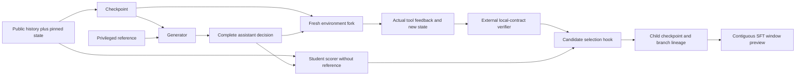

# Tool-boundary rewrite: review version 1

This implements the model-free core discussed on2026-11-02. It does not launch
models, run training, modify old experiments, or claim to reproduce paper MCMC.
The upstream math/chemistry code and current native Claude Code harness are
unchanged. Source is on `research/tool-boundary-rewrite`, based on050ceb9.

## Read these three paths first

1. `../src/append_rewrite/tool_blocks/trace.py`: public message normalization and
   complete interaction boundaries, including parallel tools and final replies.
2. `../src/append_rewrite/tool_blocks/engine.py`: checkpoint identity,
   `evaluate_action`, generation/scoring separation and local selection.
3. `../tests/test_tool_blocks.py`: changed actions must get changed observations;
   copied/foreign feedback, stale state and reference leakage cannot pass.



## Three units, deliberately separate

| Unit | Definition | Purpose |
|---|---|---|
| Interaction | Consecutive assistant records plus ALL results for its tool batch | Catalog and safe boundaries |
| Candidate | One complete assistant decision, executed in a fresh fork | Compare alternatives from one checkpoint |
| SFT window | One or more complete contiguous interactions on one lineage | Preserve feedback-driven learning across calls |

A block is not a fixed number of tokens, nor necessarily one physical tool call.
All outstanding parallel results must arrive before a boundary. Out-of-order
results are allowed; missing, repeated, foreign and orphan IDs fail closed.
Assistant text-only replies form reply blocks. Another decision after a final
assistant reply needs an explicit new user message; do not invent one.

Use an already selected, observable mainline projection. Raw native records,
private thinking, images and malformed JSON are rejected by this first core.
Existing `claude_protocol` handles native source selection/projection separately.
No partial command or JSON argument is repaired by guessing.

## State and trust

`Checkpoint` binds immutable public history, snapshot URI/digest, environment
identity, required state scopes, parent checkpoint and branch ID. Records reload
with integrity checks. Capture is a trusted runner operation at the END of that
history while the environment is paused. A digest binds bytes; it does not prove
an arbitrary historical transcript actually occurred in that snapshot.

An old trajectory catalog lists possible message boundaries only. Without a
snapshot captured at that boundary, it is NOT an executable historical fork.
Do not attach a completed rollout's final files to an earlier history cursor.

Each candidate forks a new environment and verifies its starting identity. Only
assistant messages may come from the generator. Tool feedback must come from
`Session.execute`, bound to branch ID, action hash and before/after state. A
changed action gets its own execution and observations. External verifiers may
inspect the branch but must not mutate it or inject private grading feedback
into student history. Sessions close after capture, including on errors.

Runtime adapters and scorers are trusted controller components; these hashes are
not remote attestation against a malicious plugin. Infrastructure failures are
holds, not model0s. Held branches and their owned files remain evidence. There
is no retry loop, model fallback, coordinator budget or new concurrency setting.

## Implemented executable adapter

`state.py` contains a directory fixture with real Read/Write operations. Snapshot
restoration includes file bytes, modes and empty directories; it rejects symlinks,
nonregular objects, path escapes and corrupt blobs. Each fork has a distinct
physical directory. The adapter allows read-only batches, and rejects mixed or
parallel writes rather than invent native ordering semantics.

Its identity is `directory-read-write-fixture.v1`, with state scope
`file_contents_modes_directories`. It is NOT a native Claude Code replacement,
a cloud sandbox, a process snapshot, a database snapshot or a complete filesystem
snapshot including timestamps/inodes. Task-required scopes must be explicit.
Unsupported native Bash/Edit/tools require a production adapter; no local shell
fallback executes saved model commands.

## Scoring and selection

`Generator.propose(history, reference)` sees reference only through the separate
argument. `Scorer.score(history, assistant_action)` sees no reference or newly
produced observations. Each score binds the old history and proposed action,
student model/backend identity, summed logprob and token count. The local policy
compares mean assistant-action logprob after contract admission; it cannot rank
across different checkpoint/model/backend identities.

A verifier may reject a high-likelihood action. A local-contract pass is NOT
proof of completed task, useful exploration or trainability. In production,
progress gates must permit legitimate investigation rather than demand final
reward1 after every `Read`. Choosing fork points, evaluating multi-step progress,
and preventing useless-but-likely loops remain research policy work.

This one-step selection hook is not full-trajectory likelihood scoring, detailed
balance, MH acceptance or an implementation of the original paper. The demo
uses explicitly marked fixture scores, not claimed model probabilities. A real
scorer still needs the exact student weights/tokenizer/chat template; tool IDs
and transport metadata must not be accidentally counted as generated tokens.

## SFT preview

`window_preview(trace,start_block,end_block)` exports the entire preceding public
context and a contiguous target window. Only assistant messages in that window
have loss enabled. Historical assistant messages and tool results remain context
with loss disabled. Complete tool observations stay in the conversation so later
actions see real feedback. Expert-reference markers in history fail closed;
there is no silent removal or moving answers into attachments. This marker
check does not detect unmarked answer leakage; semantic/copy review is separate.

The loss flags are MESSAGE-level specifications, not tokenizer-aligned masks.
The output stays `training_admitted=false` pending tokenizer alignment, task/trace
review and privileged-answer reuse review. A short or verbatim copied correct
answer is not automatically rejected or called effective rewrite. Existing
`claude_review.source_overlap` can support later code/proof reuse audits.

## Production integration still required

- Native Claude Code pause/capture at the next decision boundary, with complete
  task-specific state restoration and source-bound public history import.
- A generator adapter preserving native harness tools and actual termination,
  rather than a new custom model loop disguised as Claude Code.
- Same-weight student logprob scoring without reference; wire/token alignment
  and evidence that feedback/reference tokens do not enter the score.
- Per-task local/progress verifiers, longer continuation evaluation and final
  capture/fresh-score admission. No automatic reward1 gate for every tool call.
- Tokenizer-specific SFT loss masks and final data admission. No teacher rollout
  or paid sampling is implemented or authorized by this review scaffold.

## Run without a model

From the repository, use a fresh persistent external OUTPUT directory:

```sh
PYTHONPATH=agentic/src python -m append_rewrite.tool_blocks.cli demo --output OUTPUT
PYTHONPATH=agentic/src python -m unittest discover -s agentic/tests -q
```

The demo makes two independent file forks. A wrong branch deliberately has the
higher fixture likelihood but fails the contract. The selected branch writes the
right output, then a child fork reads its own output. The parent stays unchanged.
`summary.json`, branch receipts, checkpoint records and `sft-preview.json` expose
the whole model-free flow for review. All files are fixtures; none is training
admitted or evidence of model difficulty.

For existing public traces, catalog only (no model/environment execution):

```sh
PYTHONPATH=agentic/src python -m append_rewrite.tool_blocks.cli catalog \
  --messages PUBLIC_MESSAGES.json --prefix-count N --output NEW_CATALOG_DIR
```

## Real scoring capability check

The2026-11-02 minimal API check found generated-token logprobs, but the tested
completions/echo and prompt-logprob extensions did not expose supplied candidate
input probabilities. `Scorer` therefore remains an unconnected production
interface; fixture scores must never be promoted to model scores. See the
[probe evidence summary](../experiments/logprob-capability-20261102/README.md).
