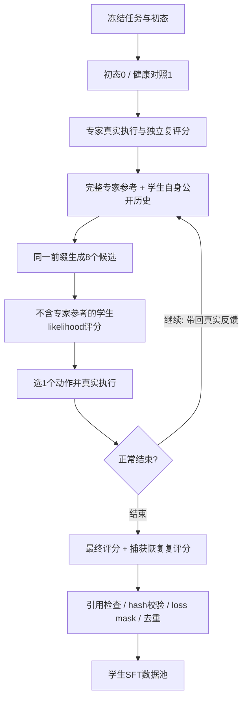

# 面向可执行 Agent 的学生分布轨迹适配

**Research proposal & worklog · v0.5 · 2026-11-06**

研究阶段：531对方法/专家数据已完成batch16、1epoch训练；两组正在继续第二个epoch。现有TB2.1三组评测包含超时补测与基础设施异常，训练收益尚待可靠配对验证。

最近更新：2026-11-06，Asia/Shanghai。轻量SWE先导已完成；官方Lite test300的三组全量Pass@1已挂队列。运行进度见带时间的worklog和实验收据。

> **研究主张**：让强模型提供成功经验，让学生在真实环境中重新完成任务，再用学生自身的无参考 likelihood 选择行为，目标是构造可执行、可验证、与学生分布更相容的 SFT 数据。最终检验标准是训练后独立解决新任务的能力，而不是造数据时带参考能否拿到1分。

本文前半部分维护研究问题和方法，后半部分维护结果摘要。逐日实验记录放在[月度 worklog](worklog/2026-11.md)，维护方式见[维护约定](MAINTENANCE.md)。

## 1. 为什么做这个研究

强模型成功轨迹包含值得学习的诊断、规划和修复经验；但直接模仿可能面临行为分布差异。另一方面，当学生几乎采不到成功轨迹时，仅筛选学生自己的成功样本也难以获得足够监督。

我们希望连接两者：**专家提供能力信息，学生负责生成训练目标，真实环境提供执行反馈，最终裁判保证交付正确。** 生成阶段可以看到专家参考，训练及最终评测时不提供参考。

当前采用两类素材：CLI-Gym提供可规模化的环境修复任务；此前baseline→依赖需求append→失败→single-step的演化任务提供较深的能力边界案例。后者是否落在Qwen的学习甜区，仍需直接测量，不能从DeepSeek的成败边界推定。

### 三个核心问题

| 问题 | 可检验假设 | 怎样证伪 |
|---|---|---|
| 专家信息是否帮助探索？ | 相同初态下，参考组比无参考组更容易完成任务 | 多题、多次尝试后没有稳定差异 |
| likelihood选择是否改善可学习性？ | 相同任务及训练token下，8选1数据优于直接参考数据和原专家数据 | SFT后无参考评测不优，或优势只来自更多采样 |
| 这种数据构造是否值得规模化？ | 单位计算成本带来的held-out提升更高，并保持已有能力 | 仅提高采集得分，训练无收益、泛化变差或成本过高 |

## 2. 原论文方法：先看目标，再看采样与训练

[Finetuning with Sampling](https://arxiv.org/abs/2610.02140)将专家信息转为更适合学生学习的回答。设$q$为问题、$e$为完整专家解答、$y$为学生回答，$p_0$是采样时冻结的学生。理想目标是在保留正确性/信息的集合$\mathcal C$内，尽量接近学生原分布：

$$
p_{\mathcal C}=\arg\min_{\rho:\operatorname{supp}(\rho)\subseteq\mathcal C}D_{KL}(\rho\|p_0),
\qquad p_{\mathcal C}(y\mid q)\propto p_0(y\mid q)\mathbf1[y\in\mathcal C].
$$

**方法主线：完整专家参考 → 学生分块续写 → 随机截断并重写后缀 → 按学生自身分布修订 → 用最终回答做普通SFT。** 随机切点可落在当前全部前缀中，包括此前的块。

| 环节 | 条件与目的 |
|---|---|
| Proposal生成 | 输入$q,e$及当前学生前缀，让专家帮助提供正确信息 |
| 目标概率评分 | 固定候选，额外forward计算$p_0(y\mid q)$；不带专家$e$ |
| 理论接受规则 | MH同时考虑目标概率比、proposal正反向概率比 |
| 最终SFT | 训练$q\to\widehat y$；专家参考不进入训练输入，中间候选不自动变成训练条目 |

理论MH接受概率为：

$$
\alpha(y\to y')=\min\!\left(1,
\frac{p_{\mathcal C}(y'\mid q)\,\kappa_e(y\mid y')}
{p_{\mathcal C}(y\mid q)\,\kappa_e(y'\mid y)}\right).
$$

$\kappa_e$是含专家参考和截断机制的proposal核。未知归一化常数抵消；符合相应条件时，概率接受/拒绝才与目标采样相联系。**论文实际实现**在附录C.2另用了“更高likelihood就替换”的近似，官方数学代码比较的是无参考平均logprob，不应与理论MH混为一谈。

得到最终$\widehat y$后，才更新训练模型$p_\phi$：

$$
\mathcal L_{SFT}(\phi)=-\mathbb E_{(q,\widehat y)}\sum_t\log p_\phi(\widehat y_t\mid q,\widehat y_{<t}).
$$

[完整方法导读：公式推导、随机截断小例子、32/58块与训练样本计数](paper-notes/finetuning-with-sampling.md) · [原论文§4](https://arxiv.org/html/2610.02140v1#S4) · [实际近似C.2](https://arxiv.org/html/2610.02140v1#A3.SS2)

## 3. Related work：我们借鉴什么

| 工作 | 与本研究有关的要点 | 我们的区别或用途 |
|---|---|---|
| [Finetuning with Sampling，2026](https://arxiv.org/abs/2610.02140) | 将专家数据适配到学生分布，再做SFT | 本研究的直接起点；从文本生成转向真实工具交互 |
| [Reasoning with Sampling，2025](https://arxiv.org/abs/2510.14901) | 用迭代采样和模型likelihood改善推理，参数保持不变 | 区分推理时采样收益与采样后训练收益 |
| [STaR，2022](https://arxiv.org/abs/2203.14465) | 生成、答案条件化rationalization、筛选、再训练 | “有提示生成、无提示学习”的早期参照 |
| [Self-Distillation Enables Continual Learning，2026](https://arxiv.org/abs/2601.19897) | 从演示条件化的自身教师获得学习信号 | 为新能力获取与旧能力保持提供对照；本文先采用普通SFT |
| [Self-Distilled Reasoner，2026](https://arxiv.org/abs/2601.18734) | 同一模型在不同上下文下形成教师与学生，进行分布蒸馏 | 当前不是逐token教师分布KL训练，而是选定轨迹后SFT |
| [POPE，2026](https://arxiv.org/abs/2601.18779) | 用oracle信息帮助困难问题上的探索 | 支持“专家参考用于探索”的动机；本阶段不运行RL |
| [On-Policy Context Distillation，2026](https://arxiv.org/abs/2602.12275) | 将上下文中的经验通过学生轨迹和蒸馏内化 | 后续可与直接轨迹SFT比较，验证参考知识能否真正脱离上下文 |
| [Twisted Sequential Monte Carlo，2024/2025](https://arxiv.org/abs/2410.01920) | 对部分解估计未来价值并重新分配采样 | 提醒我们：局部高likelihood不等于长程成功；多状态粒子属于后续研究 |
| [CLI-Gym，2026](https://arxiv.org/abs/2602.10999) | 从健康环境反演出故障任务，公开1655个实例 | 当前的主要执行任务池，不预设每个发布实例都能直接验收 |

### 帖子带来的统一视角

Shengyu Feng的[A Gallery of Methods Beyond RL — Part I](https://shengyu-feng.github.io/blog/2026/08/27/beyond-RL/)从目标分布讨论重要性采样、TSMC与MCMC。用户提供的中文PDF是2026-11-04的转载阅读版本；原帖发表于2026-08-27，它不是对随后发布的《Finetuning with Sampling》的解读。

这个视角启发我们将工作拆成两件事：**先定义希望得到怎样的行为分布，再决定如何生成及学习这些行为。** 采样时提高成功率，与把收益内化到参数中，是两项需要分别验证的结果。本文没有实现重要性重采样、TSMC或严格MH。

## 4. Formulation与当前方法

### 4.1 理想目标与工程近似

Agent版沿用上节的信息投影视角，将文本回答换成真实环境交互轨迹$\tau$，并用最终交付定义合格集合$\mathcal C(x)$。其工程实现如下。

**当前实现是受此启发的局部选择方法，不宣称采到了这个全轨迹目标分布。** 这里的概率指固定初态和环境转移核下，策略诱导的交互分布；环境反馈作为后续动作的条件，不当作模型生成token评分。历史动作会改变文件、进程和下一次观测；仅拼接文本后缀不能替代真实执行。

### 4.2 一条数据怎样产生

1. 冻结任务instruction、故障初态、健康对照、裁判及运行身份；检查初态0、健康对照1。
2. DeepSeek Flash在真实环境中完成专家轨迹，并通过原评分和独立恢复评分。
3. Qwen3.8-27B base从相同故障初态开始。生成输入包含任务、**完整可观察专家轨迹**和学生自己已经执行的历史。
4. 在同一公开前缀下生成8个候选，重建不含专家参考的评分输入，用Qwen自身input logprob评分。
5. 选最高分的合法候选，**只执行这一条动作**，接收真实反馈，再进入下一块。
6. 正常结束后评分、捕获最终状态、独立恢复复评分；只有合格正例进入SFT导出。
7. 从学生真实公开对话导出训练条目，不包含生成请求中的特权参考；assistant输出参与loss，用户任务及环境反馈不参与loss。

**块的粒度**是一次完整Terminus-2 assistant动作JSON及其真实反馈；一个JSON可以包含多条shell命令。交互轮次、命令条目、候选数是三种指标，不能混为一谈。

记公开前缀为$h_t$，完整专家参考为$e$。生成与评分分别为：

$$
a_t^{(i)}\sim p_\theta(\cdot\mid h_t,e),\quad i=1,\ldots,8;
\qquad S(a\mid h_t)=\frac1{|a|}\sum_j\log p_\theta(a_j\mid h_t,a_{<j}).
$$

在语法合法且评分完整的候选中选择$\arg\max_i S(a_t^{(i)}\mid h_t)$。评分者是**Qwen学生本身，不是DeepSeek专家**；评分上下文由公开历史重新渲染，不是读取带参考生成时的output logprob。其精确token边界、chat template和tokenizer均需对齐。动作$a$是完整assistant JSON，包括公开plan/analysis字段，不是仅给shell命令评分；provider隐藏reasoning不进入评分或SFT。

每步不调用任务verifier、不执行落选动作、不回退环境，也不额外按“看起来有进展”或重复率打分。当前候选池不完整时停止该尝试，保留候选与现场。只对明确可重试的零生成评分请求做有限传输重试，不自动重跑付费生成或整条轨迹。

### 4.3 与原论文的关系应怎样表述

| 维度 | 原论文/官方实现 | 当前Agent版 |
|---|---|---|
| 改写对象 | 文本推理序列与后缀 | 当前真实交互位置的完整动作块 |
| 专家条件 | 专家解题轨迹 | 完整可观察专家交互，作为参考而非学生执行历史 |
| 修订位置 | 随机截断已有前缀并重采后缀 | 固定最新块，不撤销已经执行的动作 |
| 选择规则 | 正文给出MH；附录C.2及开源实现采用更高likelihood替换的近似 | 每块8候选中选最高无参考平均logprob |
| 状态处理 | 文本可直接替换 | 仅执行选中动作，下一步必须使用真实观测 |

原论文并非全部实验都使用完整MH接受率。其[附录C.2](https://arxiv.org/html/2610.02140v1#A3.SS2)说明近似；[开源代码](https://github.com/aakaran/finetuning-with-sampling/blob/main/boost_math.py)也以平均logprob比较候选。我们仍然省去了跨历史位置的修订能力；局部argmax及长度归一化也不能直接继承理论目标的采样保证。

因此，当前数据也不是无参考学生策略的严格on-policy样本；准确称呼是“专家参考条件下生成、无参考学生likelihood选择的轨迹”。与学生分布更相容及更易学习，都是后续要检验的假设。

## 5. 实验设计：固定专家池，比较训练后的能力

**2026-11-05决策：先完成当前数据生产，再开展方法变体构造、实际SFT及对照分析。本次仅更新设计，不启动训练或新采样。** 固定同一批500条合格专家轨迹；它与当前500–1000条学生SFT产出目标不是同一个计数。

| 组别 | 数据构造 | 检验的问题 |
|---|---|---|
| E0 | 当前学生checkpoint，不训练 | 训练前无参考能力基线 |
| E1 | 原始专家成功轨迹直接SFT | 普通专家蒸馏是否已经足够？ |
| E2 | 完整专家参考，每轮单候选并真实执行 | 学生改写本身是否有效？ |
| E3 | 当前方法：完整参考、每轮8候选、无参考logprob选1并执行 | likelihood选择是否有额外训练收益？ |
| E4 | 固定专家历史，离线生成当前动作8候选并选1，不执行 | 是否可以省去环境交互？ |
| E5，后续 | assistant输出内部按明确边界分chunk生成与选择 | 更细粒度选择是否更有效？ |

首轮优先E0–E4；chunk边界及候选评分协议明确后再开展E5。无参考成功筛选/RFT、随机8选1及K值消融列为后续对照，不默认铺满矩阵。所有训练输入与最终评测输入均不含额外专家参考。

**主比较匹配实际有监督token与训练配置；另做等合成计算预算的效率比较。** 固定500条专家不等于固定训练量。各方法构造失败、不同保留率与项目覆盖须完整报告；共同来源交集比较和全池实际产出比较分列，不能静默替换失败来源。完整episode与单轮动作条目的数量分开统计。

训练前冻结学生checkpoint、tokenizer/template、loss mask、上下文长度及截断/packing策略、有效batch、优化器、学习率/调度和随机种子；匹配更新规模并记录实际训练token偏差，不能只匹配epoch。训练具体参数与种子数尚未决定，开跑前锁定。

**主要终点：TB2.1官方89题、无参考Pass@1相对E0及E1的提升。** 所有checkpoint使用一致harness、thinking配置、任务时限、资源映射和可控服务负载；当前共享服务延迟问题须先解决，运行/API/捕获/裁判异常分列，不补作有效模型0。保留官方原始结果，主成功指标只计所有必需检查通过。

按project/repository及任务谱系划分训练/开发素材，append祖先后代与故障近重复不跨split。官方TB2.1题目、解法及轨迹不进入训练；用独立开发集选择方法/参数，TB2.1作为最终比较，不反复据其得分调参。必要时以任务或来源项目为单位估计不确定性；单次Pass@1排序不自动构成稳定优势。

采集成功、logprob、轨迹长度与复制率是中间指标，不能替代训练收益。只有匹配条件下的训练后能力及成本证据支持，才形成最终claim；简单方法最好或没有提升也应如实报告。

[完整预注册式实验方案：变体协议、离线参考边界、公平性、准入和阶段门禁](experiment-design.md)。已有方法及历史结果保留；当前有效SFT指通过生产准入，不代表已经训练或已证实有收益。

## 6. 已有结果

### 6.1 Coq append3三组对照，2026-11-03

同一Qwen3.8-27B base、Terminus-2、任务与起始文件。**这是Coq实验，不是CLI-Gym。**

| 指标 | 我们的方法：参考＋8选1 | 直接参考专家 | 完全无参考、单次生成 |
|---|---:|---:|---:|
| 结束状态 | 正常 | 正常 | 经用户同意提前停止 |
| 原评分/独立复评分 | 1/1 | 1/1 | 停止时提交0/0 |
| 实际交互轮次 | 12 | 8 | 71 |
| shell命令条目 | 24 | 13 | 105 |
| Agent耗时 | 7.28分钟 | 3.20分钟 | 49.47分钟 |
| 生成请求 | 96 | 8 | 72，其中1次未执行 |
| 评分请求 | 96，在线 | 8，事后 | 0 |
| 上下文峰值 | 49.4k | 44.7k | 89.3k |
| 累计输入，生成＋评分/含缓存 | 4.90M | 0.38M | 3.25M |
| 全部生成输出token | 20,288 | 1,896 | 35,476 |
| 动作平均无参考logprob | −0.181 | −0.321 | — |

结论范围：参考帮助了这一次完成任务；8选数据的自身似然更高，但直接参考更便宜、同样成功。无参考是提前停止，不是正常到时得0。两组轨迹的状态分布和长度不同，不能将最终平均logprob差当作因果效应或训练收益。早期原始导出有悬空专家引用的质量hold，不将其直接计入当前CLI-Gym训练准入数。[结构化证据](evidence/coq-three-settings-20261103.json)

### 6.2 TB4与CLI-Gym试点：最终完整样本均值

| 指标 | TB4专家 n=107 | CLI专家 n=4 | TB4学生 n=16 | CLI学生 n=3 |
|---|---:|---:|---:|---:|
| 交互轮次 | 62.90 | 20.75 | 9.81 | 11.00 |
| 耗时/分钟 | 36.15 | 16.53 | 17.14 | 17.14 |
| 上下文峰值 | 72.8k | 26.4k | 45.6k | 45.2k |
| 生成累计输入/含缓存 | 4.43M | 0.40M | 3.61M | 4.13M |
| 评分累计输入 | — | — | 1.25M | 1.07M |
| 全部生成输出token | 298.0k | 71.7k | 44.7k | 30.8k |

**收尾后的解释**：CLI-Gym专家明显更轻量；学生平均耗时基本持平，生成＋评分输入约5.19M，对照TB4约4.86M，并未减少。早期只结束两条CLI学生时的“更快、更省”不能外推为最终结论。两批后端分别为ECS Docker与Alibaba，且任务分布及样本量不同；不能把差异全归因于任务池。

此表只覆盖正常完整轨迹，排除续跑及异常；异常消耗仍需计入总体成本。CLI试点六个来源中，四题进入模型阶段、三题学生形成合格SFT、一题学生上游502，两题预检排除。[结构化证据](evidence/pilot-vs-tb4-20261104.json)

### 6.3 首版531对SFT交付，2026-11-05

共享531个原始输入身份，顺序一一对应。学生产出完成500条目标下限；专家是对应成功轨迹，未为本次导出新增采样。

| 指标 | 当前方法：Qwen参考＋8选1 | 原始DeepSeek Flash专家 |
|---|---:|---:|
| 完整轨迹 | 531 | 531 |
| 平均交互轮次 | 8.27 | 12.78 |
| 平均工具命令条目 | 19.21 | 33.79 |
| 平均完整序列token | 10,695 | 19,907 |
| 序列token P90 | 18,224 | 35,539 |
| 最长序列token | 48,205 | 92,153 |
| 累计assistant监督token | 1,526,318 | 2,225,915 |
| 超过32k / 64k | 3 / 0 | 69 / 2 |
| 权重训练（20:43） | 33/531更新 | 45/531更新 |
| 训练后TB2.1收益 | 待训练与统一评测完成 | 待训练与统一评测完成 |

两组使用同一冻结Qwen tokenizer/template与assistant-only loss mask，逐条完整重编码及标签验证通过；未截断，不包含额外专家参考或隐藏reasoning。4条复用专家追溯原收据，3份早期历史从原位置补齐。任务合同及初态身份一致，各自实际终端反馈保留。

完整序列token是历史序列化一次，不是生产累计输入；工具计数为commands条目，不是候选数。学生平均轮次/序列更短不证明更易学习；相同531条下专家监督量为1.46倍，等监督token预算仍是后续补充消融。本次全部531条用于训练，不额外留出dev；当前为同任务/同epoch/同参数对照，非等监督token预算。[完整配对比较](paired-sft-comparison.md) · [统计与数据SHA](evidence/paired-sft-531-20261105.json)。

生产并发、传输切换及175条阶段快照留在11月4日worklog和既有evidence；不将历史运行状态标为当前。当前保留原生Terminus公开JSON和关闭额外thinking的模板，变更thinking须独立对齐协议。

## 7. 后续实验路线与当前重点

| 优先级 | 工作 | 关键对照 |
|---|---|---|
| P0 | 先建立更快的真实仓库修复开发评测；收尾第二轮训练 | Base / 专家SFT(E1) / 我们的方法(E3)，冻结产物与统一协议 |
| P1 | 补直接参考、无候选的学生SFT(E2) | E1→E2检验改写；E2→E3检验8候选选择 |
| P2 | 数据可学习性筛选 | 随机 / 学生无参考较难而参考可完成 / 难易混合，同监督token |
| P3 | recipe | 配对比较1/2epoch，再单独改LR/训练token；不同时变多项 |
| P4 | domain多样性 | 同token的同域加量与新域扩展，分开评估项目/领域迁移 |
| P5 | 低成本与结构消融 | 在线E3对离线动作E4；K与随机选择后续单独比较 |

P0先试SWE-bench Lite官方dev：固定3个较轻Python项目各2题，共6题；5题通过门禁进入三组Pass@1，1题官方环境兼容性hold单列，记录实际耗时与异常率。先导方法5/5、Base与专家各3/5；随后按用户授权独立启动官方test300全量三组对照，共900次计划尝试，不把先导当官方得分。固定当前epoch1 step34部署，epoch2不覆盖；TB2.1与训练继续保持原身份。

现有531对是同任务/同epoch对照，方法与专家监督token不相等；后续构造消融以等监督token为主要比较轴。无参考数据分层只在训练素材进行，不能用评测失败题回流训练。详细假设、对照、准入、停止与报告规则见[实验设计](experiment-design.md)。

工程实现已在[研究分支](https://github.com/kfq20/finetuning-with-sampling/tree/research/tool-boundary-rewrite)维护。当前方法入口包括[候选选择](https://github.com/kfq20/finetuning-with-sampling/blob/d899220/agentic/src/append_rewrite/terminus/blockwise.py)、[生成参考拼接](https://github.com/kfq20/finetuning-with-sampling/blob/d899220/agentic/src/append_rewrite/terminus/episode.py)、[SFT导出](https://github.com/kfq20/finetuning-with-sampling/blob/d899220/agentic/src/append_rewrite/terminus/export.py)和[分波生产](https://github.com/kfq20/finetuning-with-sampling/blob/d899220/agentic/experiments/cli-gym-scale-20261104/campaign.py)。论文、方法和运行身份分别版本化；本研究文档不更改已冻结实验。
