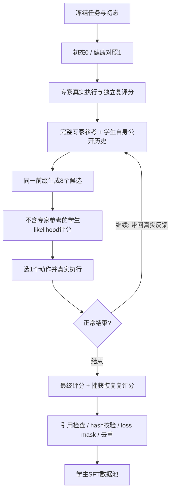

# 面向可执行 Agent 的学生分布轨迹适配

**Research proposal & worklog · v0.1 · 2026-11-04**  
研究阶段：方法与采集闭环已验证；正在构建首版500–1000条数据池；训练收益尚待对照实验。  
最新实验核验：2026-11-04 12:00，Asia/Shanghai。

> **研究主张**：让强模型提供成功经验，让学生在真实环境中重新完成任务，再用学生自身的无参考 likelihood 选择行为，目标是构造可执行、可验证、与学生分布更相容的 SFT 数据。最终检验标准是训练后独立解决新任务的能力，而不是造数据时带参考能否拿到1分。

本文前半部分维护研究问题和方法，后半部分维护结果摘要。逐日实验记录放在[月度 worklog](worklog/2026-11.md)，维护方式见[维护约定](MAINTENANCE.md)。

## 1. 为什么做这个研究

强模型成功轨迹包含值得学习的诊断、规划和修复经验；但直接模仿可能面临行为分布差异。另一方面，当学生几乎采不到成功轨迹时，仅筛选学生自己的成功样本也难以获得足够监督。

我们希望连接两者：**专家提供能力信息，学生负责生成训练目标，真实环境提供执行反馈，最终裁判保证交付正确。** 生成阶段可以看到专家参考，训练及最终评测时不提供参考。

当前采用两类素材：CLI-Gym提供可规模化的环境修复任务；此前baseline→依赖需求append→失败→single-step的演化任务提供较深的能力边界案例。后者是否落在Qwen的学习甜区，仍需直接测量，不能从DeepSeek的成败边界推定。

### 三个核心问题

| 问题 | 可检验假设 | 怎样证伪 |
|---|---|---|
| 专家信息是否帮助探索？ | 相同初态下，参考组比无参考组更容易完成任务 | 多题、多次尝试后没有稳定差异 |
| likelihood选择是否改善可学习性？ | 相同任务及训练token下，8选1数据优于直接参考数据和原专家数据 | SFT后无参考评测不优，或优势只来自更多采样 |
| 这种数据构造是否值得规模化？ | 单位计算成本带来的held-out提升更高，并保持已有能力 | 仅提高采集得分，训练无收益、泛化变差或成本过高 |

## 2. Related work：我们借鉴什么

| 工作 | 与本研究有关的要点 | 我们的区别或用途 |
|---|---|---|
| [Finetuning with Sampling，2026](https://arxiv.org/abs/2610.02140) | 将专家数据适配到学生分布，再做SFT | 本研究的直接起点；从文本生成转向真实工具交互 |
| [Reasoning with Sampling，2025](https://arxiv.org/abs/2510.14901) | 用迭代采样和模型likelihood改善推理，参数保持不变 | 区分推理时采样收益与采样后训练收益 |
| [STaR，2022](https://arxiv.org/abs/2203.14465) | 生成、答案条件化rationalization、筛选、再训练 | “有提示生成、无提示学习”的早期参照 |
| [Self-Distillation Enables Continual Learning，2026](https://arxiv.org/abs/2601.19897) | 从演示条件化的自身教师获得学习信号 | 为新能力获取与旧能力保持提供对照；本文先采用普通SFT |
| [Self-Distilled Reasoner，2026](https://arxiv.org/abs/2601.18734) | 同一模型在不同上下文下形成教师与学生，进行分布蒸馏 | 当前不是逐token教师分布KL训练，而是选定轨迹后SFT |
| [POPE，2026](https://arxiv.org/abs/2601.18779) | 用oracle信息帮助困难问题上的探索 | 支持“专家参考用于探索”的动机；本阶段不运行RL |
| [On-Policy Context Distillation，2026](https://arxiv.org/abs/2602.12275) | 将上下文中的经验通过学生轨迹和蒸馏内化 | 后续可与直接轨迹SFT比较，验证参考知识能否真正脱离上下文 |
| [Twisted Sequential Monte Carlo，2024/2025](https://arxiv.org/abs/2410.01920) | 对部分解估计未来价值并重新分配采样 | 提醒我们：局部高likelihood不等于长程成功；多状态粒子属于后续研究 |
| [CLI-Gym，2026](https://arxiv.org/abs/2602.10999) | 从健康环境反演出故障任务，公开1655个实例 | 当前的主要执行任务池，不预设每个发布实例都能直接验收 |

### 帖子带来的统一视角

Shengyu Feng的[A Gallery of Methods Beyond RL — Part I](https://shengyu-feng.github.io/blog/2026/08/27/beyond-RL/)从目标分布讨论重要性采样、TSMC与MCMC。用户提供的中文PDF是2026-11-04的转载阅读版本；原帖发表于2026-08-27，它不是对随后发布的《Finetuning with Sampling》的解读。

这个视角启发我们将工作拆成两件事：**先定义希望得到怎样的行为分布，再决定如何生成及学习这些行为。** 采样时提高成功率，与把收益内化到参数中，是两项需要分别验证的结果。本文没有实现重要性重采样、TSMC或严格MH。

## 3. Formulation与当前方法

### 3.1 理想目标与工程近似

记任务为$x$，学生为$p_\theta$，环境交互轨迹为$\tau$，有效交付集合为$\mathcal C(x)$。一个理想目标是：

$$
q^*=\arg\min_{q:\operatorname{supp}(q)\subseteq\mathcal C(x)}D_{KL}(q\|p_\theta),
\qquad q^*(\tau\mid x)\propto p_\theta(\tau\mid x)\mathbf1[\tau\in\mathcal C(x)].
$$

这是原论文的信息投影视角。它要求同时关注正确性和学生分布，而不只是搜集更多专家答案。[原论文§4](https://arxiv.org/html/2610.02140v1#S4)

**当前实现是受此启发的局部选择方法，不宣称采到了这个全轨迹目标分布。** 这里的概率指固定初态和环境转移核下，策略诱导的交互分布；环境反馈作为后续动作的条件，不当作模型生成token评分。历史动作会改变文件、进程和下一次观测；仅拼接文本后缀不能替代真实执行。

### 3.2 一条数据怎样产生

1. 冻结任务instruction、故障初态、健康对照、裁判及运行身份；检查初态0、健康对照1。
2. DeepSeek Flash在真实环境中完成专家轨迹，并通过原评分和独立恢复评分。
3. Qwen3.8-27B base从相同故障初态开始。生成输入包含任务、**完整可观察专家轨迹**和学生自己已经执行的历史。
4. 在同一公开前缀下生成8个候选，重建不含专家参考的评分输入，用Qwen自身input logprob评分。
5. 选最高分的合法候选，**只执行这一条动作**，接收真实反馈，再进入下一块。
6. 正常结束后评分、捕获最终状态、独立恢复复评分；只有合格正例进入SFT导出。
7. 从学生真实公开对话导出训练条目，不包含生成请求中的特权参考；assistant输出参与loss，用户任务及环境反馈不参与loss。

**块的粒度**是一次完整Terminus-2 assistant动作JSON及其真实反馈；一个JSON可以包含多条shell命令。交互轮次、命令条目、候选数是三种指标，不能混为一谈。

记公开前缀为$h_t$，完整专家参考为$e$。生成与评分分别为：

$$
a_t^{(i)}\sim p_\theta(\cdot\mid h_t,e),\quad i=1,\ldots,8;
\qquad S(a\mid h_t)=\frac1{|a|}\sum_j\log p_\theta(a_j\mid h_t,a_{<j}).
$$

在语法合法且评分完整的候选中选择$\arg\max_i S(a_t^{(i)}\mid h_t)$。评分者是**Qwen学生本身，不是DeepSeek专家**；评分上下文由公开历史重新渲染，不是读取带参考生成时的output logprob。其精确token边界、chat template和tokenizer均需对齐。动作$a$是完整assistant JSON，包括公开plan/analysis字段，不是仅给shell命令评分；provider隐藏reasoning不进入评分或SFT。

每步不调用任务verifier、不执行落选动作、不回退环境，也不额外按“看起来有进展”或重复率打分。当前候选池不完整时停止该尝试，保留候选与现场。只对明确可重试的零生成评分请求做有限传输重试，不自动重跑付费生成或整条轨迹。

### 3.3 与原论文的关系应怎样表述

| 维度 | 原论文/官方实现 | 当前Agent版 |
|---|---|---|
| 改写对象 | 文本推理序列与后缀 | 当前真实交互位置的完整动作块 |
| 专家条件 | 专家解题轨迹 | 完整可观察专家交互，作为参考而非学生执行历史 |
| 修订位置 | 随机截断已有前缀并重采后缀 | 固定最新块，不撤销已经执行的动作 |
| 选择规则 | 正文给出MH；附录C.2及开源实现采用更高likelihood替换的近似 | 每块8候选中选最高无参考平均logprob |
| 状态处理 | 文本可直接替换 | 仅执行选中动作，下一步必须使用真实观测 |

原论文并非全部实验都使用完整MH接受率。其[附录C.2](https://arxiv.org/html/2610.02140v1#A3.SS2)说明近似；[开源代码](https://github.com/aakaran/finetuning-with-sampling/blob/main/boost_math.py)也以平均logprob比较候选。我们仍然省去了跨历史位置的修订能力；局部argmax及长度归一化也不能直接继承理论目标的采样保证。

因此，当前数据也不是无参考学生策略的严格on-policy样本；准确称呼是“专家参考条件下生成、无参考学生likelihood选择的轨迹”。与学生分布更相容及更易学习，都是后续要检验的假设。

## 4. 实验设计：最终要证明什么

### 4.1 首轮训练对照（计划，尚未启动）

| 组别 | 训练材料 | 作用 |
|---|---|---|
| E0 | 不训练的Qwen base | 无参考能力基线 |
| E1 | 原始成功专家轨迹 | 普通专家SFT |
| E2 | 学生直接参考专家，单次生成 | 排除“只是有参考就够了”的解释 |
| E3 | 当前参考＋每块8选1的学生轨迹 | 检验likelihood选择的额外价值 |
| E4，可选 | 无参考学生自己采出的成功轨迹 | 与普通成功筛选/RFT比较 |

先完成E0–E3的小规模对照，再扩展RL或更复杂的搜索。所有组训练及评测时均不提供专家参考。E4采不到足量成功数据时，如实报告，不用专家提示结果冒充无参考成功。

**比较口径**：先在同一任务交集上比较，并匹配有监督token、训练配置和更新规模；另报告整条数据构造成本。在任务数匹配和token匹配下分别查看结论，避免长轨迹或更多训练量制造优势。随机种子、训练步数、学习率、模板、tokenizer和截断策略随训练release冻结。K=1/4/8等消融在必要时开展，不默认铺满实验矩阵。

### 4.2 数据切分、学习价值与验收

- 在训练前冻结project/repository级划分；同一底座、故障recipe近重复、append祖先后代不得跨训练与测试。采集可以先覆盖全池，正式训练manifest只选择train split。
- 以CLI-Gym未见项目/任务和独立领域任务测迁移；官方TB任务及其解法/轨迹保留作评测。早期围绕benchmark派生的资产需单独做来源审查，不能默认视为干净训练数据。
- 对分层抽样任务做无参考、直接参考、8选1的重复尝试，估计成功率差及不确定性。每题pass@1的一次成败不足以确定“学习甜区”。
- 用完整成功率、任务覆盖、过程合法性、重复动作、复制依赖、输出长度和成本共同判断数据价值。高likelihood、低得分率、长轨迹都不是学习价值的充分条件。
- 主要终点是训练后**无参考held-out pass@1提升**；辅助报告旧能力保持、跨项目泛化、相同推理预算下的表现，以及增益/造数据成本。用任务或项目为单位给置信区间，相关append不当独立样本。

当前“有效SFT”指执行、评分、导出和格式验收通过的数据条目；它不代表已经完成权重训练，也不代表已证实能带来能力提升。500–1000条是首轮实验目标，不是论文证明的最低样本量。还需报告不同规模子集上的训练曲线。

### 4.3 继续与停止的依据

| 阶段 | 继续依据 | 不满足时 |
|---|---|---|
| 造数据闭环 | 正常终止、真实交付、原/复评分合格、无特权引用、hash及mask正确 | 保留失败或hold，不计正例 |
| 规模化 | 多项目有足够产出，单位有效监督token成本可接受 | 定位环境/上游损耗，不用重采样掩盖错误 |
| 方法有效性 | E3在匹配条件下优于E1/E2，且未明显损害保持能力 | 不把采集成功当研究完成；选择更便宜方法或修改选择规则 |
| 下一阶段 | 对照结果支持新假设 | teacher修复、环境fork、价值模型/TSMC等暂列研究选项 |

后续最值得检查的机制是：mean-logprob是否偏爱短而熟悉的动作；8选是否压缩有效策略多样性；正确轨迹是否只是照抄专家文件；局部高似然是否反而损害后续可达成功率。这些问题优先通过已有候选与轨迹分析，再决定是否增加采样。

## 5. 已有结果

### 5.1 Coq append3三组对照，2026-11-03

同一Qwen3.8-27B base、Terminus-2、任务与起始文件。**这是Coq实验，不是CLI-Gym。**

| 指标 | 我们的方法：参考＋8选1 | 直接参考专家 | 完全无参考、单次生成 |
|---|---:|---:|---:|
| 结束状态 | 正常 | 正常 | 经用户同意提前停止 |
| 原评分/独立复评分 | 1/1 | 1/1 | 停止时提交0/0 |
| 实际交互轮次 | 12 | 8 | 71 |
| shell命令条目 | 24 | 13 | 105 |
| Agent耗时 | 7.28分钟 | 3.20分钟 | 49.47分钟 |
| 生成请求 | 96 | 8 | 72，其中1次未执行 |
| 评分请求 | 96，在线 | 8，事后 | 0 |
| 上下文峰值 | 49.4k | 44.7k | 89.3k |
| 累计输入，生成＋评分/含缓存 | 4.90M | 0.38M | 3.25M |
| 全部生成输出token | 20,288 | 1,896 | 35,476 |
| 动作平均无参考logprob | −0.181 | −0.321 | — |

结论范围：参考帮助了这一次完成任务；8选数据的自身似然更高，但直接参考更便宜、同样成功。无参考是提前停止，不是正常到时得0。两组轨迹的状态分布和长度不同，不能将最终平均logprob差当作因果效应或训练收益。早期原始导出有悬空专家引用的质量hold，不将其直接计入当前CLI-Gym训练准入数。[结构化证据](evidence/coq-three-settings-20261103.json)

### 5.2 TB4与CLI-Gym试点：最终完整样本均值

| 指标 | TB4专家 n=107 | CLI专家 n=4 | TB4学生 n=16 | CLI学生 n=3 |
|---|---:|---:|---:|---:|
| 交互轮次 | 62.90 | 20.75 | 9.81 | 11.00 |
| 耗时/分钟 | 36.15 | 16.53 | 17.14 | 17.14 |
| 上下文峰值 | 72.8k | 26.4k | 45.6k | 45.2k |
| 生成累计输入/含缓存 | 4.43M | 0.40M | 3.61M | 4.13M |
| 评分累计输入 | — | — | 1.25M | 1.07M |
| 全部生成输出token | 298.0k | 71.7k | 44.7k | 30.8k |

**收尾后的解释**：CLI-Gym专家明显更轻量；学生平均耗时基本持平，生成＋评分输入约5.19M，对照TB4约4.86M，并未减少。早期只结束两条CLI学生时的“更快、更省”不能外推为最终结论。两批后端分别为ECS Docker与Alibaba，且任务分布及样本量不同；不能把差异全归因于任务池。

此表只覆盖正常完整轨迹，排除续跑及异常；异常消耗仍需计入总体成本。CLI试点六个来源中，四题进入模型阶段、三题学生形成合格SFT、一题学生上游502，两题预检排除。[结构化证据](evidence/pilot-vs-tb4-20261104.json)

### 5.3 当前数据生产看板

下表固定于**2026-11-04 12:00 CST**，不是实时页面。后续覆盖此表，历史保留于worklog与证据快照。

| 指标 | 已核验值 |
|---|---|
| CLI-Gym冻结来源池 | 1655题、34个完整分页 |
| 首个扩批 | 94个未尝试来源；构建成功56、构建拦截38 |
| 累计有效学生SFT | **26条**：试点3＋扩批23 |
| 有监督token | **71,444**；累计包hash及输入身份去重检查通过 |
| 扩批已结束学生 | 成功23、执行异常3；异常率3/26＝11.5% |
| 含试点已结束学生 | 成功26、执行异常4；异常率4/30＝13.3% |
| 扩批专家 | 正常结束29，其中1条原评分0；另1条运行时安装失败在模型调用前发生 |
| 实际活跃阶段 | 2条专家＋2条学生；控制进程存活、无Provider STOP |
| 扩批剩余状态 | 控制台计47个已接入，仍有9个待派发；预检与运行异常分列 |
| 训练及无参考能力增益 | 尚未进行本轮权重训练/测量 |

学生异常包括502及候选生成阶段约30秒返回的499；后者不是本次logprob评分失败。环境构建/控制门禁的拒绝不并入学生API异常率，合法模型0也不算基建错误。当前“四并发”是四个任务lane，专家与学生共享推进；学生上限4、零生成评分prefill上限2，每个动作块8候选。[核验快照](evidence/acquisition-20261104-1200.json)

## 6. 当前执行重点与近期里程碑

1. **稳定产出并交付首版数据池**：继续当前CLI-Gym生产；每波100个新来源，累计至少500个合格学生轨迹后收尾本轮。来源耗尽、资源门禁或上游阻断时明确报告，不保证1655个来源必能产出1000条正例。
2. **冻结第一版研究切分和基线**：建立同题三组小对照，量化无参考能力、参考增益、复制依赖及候选选择成本；从现有专家和学生产物准备匹配的E1/E2/E3。
3. **训练验证**：先做最小SFT对照和无参考held-out评测，再决定是否扩大8选数据、加入更强教师修复或RL。文档中的实验设计不会自动触发新模型或训练请求。

工程实现已在[研究分支](https://github.com/kfq20/finetuning-with-sampling/tree/research/tool-boundary-rewrite)维护。当前方法入口包括[候选选择](https://github.com/kfq20/finetuning-with-sampling/blob/d899220/agentic/src/append_rewrite/terminus/blockwise.py)、[生成参考拼接](https://github.com/kfq20/finetuning-with-sampling/blob/d899220/agentic/src/append_rewrite/terminus/episode.py)、[SFT导出](https://github.com/kfq20/finetuning-with-sampling/blob/d899220/agentic/src/append_rewrite/terminus/export.py)和[分波生产](https://github.com/kfq20/finetuning-with-sampling/blob/d899220/agentic/experiments/cli-gym-scale-20261104/campaign.py)。论文、方法和运行身份分别版本化；本研究文档不更改已冻结实验。
